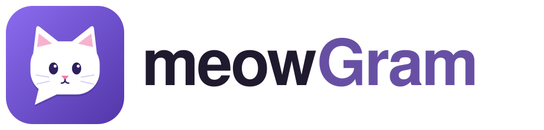

<p align="center">
  
</p>

# meowGram

A private cat-lounge chat for the purrBrews household: Flutter on web, Android,
iOS, Windows and macOS; a Go WebSocket/API server; PostgreSQL persistence.

## Design

- Authelia OpenID Connect sign-in using Authorization Code + PKCE.
- Bearer-authenticated HTTP APIs and one-use, 30-second WebSocket tickets.
- Messages are committed before broadcast; slow clients are evicted.
- Offline cache renders first; timestamp-and-UUID pagination fills reconnect gaps.
- Docker deployment with loopback port bindings and an external HTTPS proxy.
- A Flutter web/Nginx image and scheduled local PostgreSQL dumps.

The [runbook](runbook.md) is the configuration and operations reference.
[AGENTS.md](AGENTS.md) defines contribution rules and deployment boundaries.
Changes on review branches are not necessarily deployed.

## Repository

| Directory | Purpose |
|---|---|
| `client/` | Flutter UI, OIDC flow, cache, synchronization and notifications |
| `server/` | Go API, WebSocket hub, token verification and SQL migrations |
| `deploy/` | Compose stacks, builds, backups and scratch verification |

## Reproducible verification

Only Docker with Compose is required. Go, Flutter and PostgreSQL run in disposable
containers with pinned toolchains. No production environment files, credentials,
host ports or database volumes are used.

PowerShell:

```powershell
./deploy/scripts/verify.ps1
```

Linux/macOS:

```sh
sh deploy/scripts/verify.sh
```

The workflow runs Go tests with the race detector, Go vet, real PostgreSQL
migration/pagination tests, a dump/restore drill, Flutter analysis/tests and a
release web build. The scripts return failure if any check fails and clean up
their isolated stack, including a production Nginx container smoke check. Add
`-Android` (PowerShell) or `--android` (POSIX) to build a debug APK with a
synthetic Firebase configuration. Android SDK licenses are accepted inside that
scratch image; no Firebase account or signing credentials are needed. This APK
is for build verification only and cannot verify real push delivery. Downloads
need network access on the first run; Docker's image cache supports subsequent
runs. GitHub Actions runs both the standard and Android checks.

With local toolchains installed:

```sh
cd server && go test ./...
cd ../client && flutter pub get && flutter analyze && flutter test
```

Native platform builds additionally require their SDKs. Successful scratch tests
do not verify a live identity-provider registration, push delivery, device links,
macOS entitlements or off-host backup storage.

## Configuration and deployment

Use the tracked `.env.example` files and `client/config/*.json` as templates.
Real configuration belongs in ignored `.env`, `deploy/.env` and
`client/config/*.local.json` files. Never commit credentials, real domains or
signing material. Configure Authelia to issue signed JWT access tokens for the
API audience and align its client registration with the configured client ID.

See the runbook before deploying. The normal deployment stack is
`deploy/docker-compose.yml`; the scratch stack is `deploy/verify.compose.yml`.
Only the repository owner merges and authorizes changes to the live deployment.

## Releases

Tagged releases (`vX.Y.Z`) publish domain-free packages: the server and web
images on GHCR, and Android, Windows, macOS and iOS apps on the GitHub Release.
The apps ask for your server's address on first launch and read its sign-in
settings from `/api/client-config`; the web image uses its own origin. See
[runbook §10.11](runbook.md#1011-published-packages--runtime-server-configuration).
